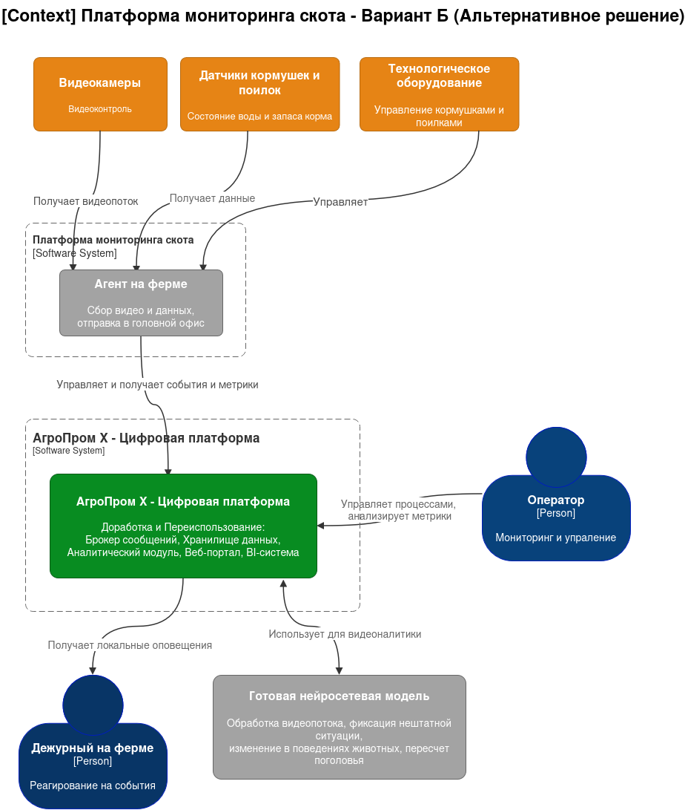
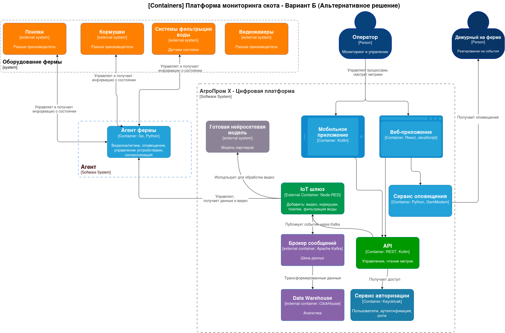
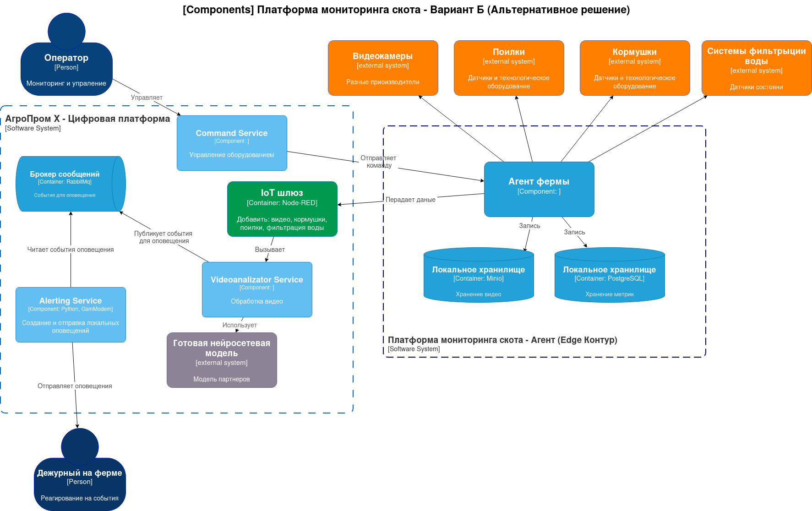
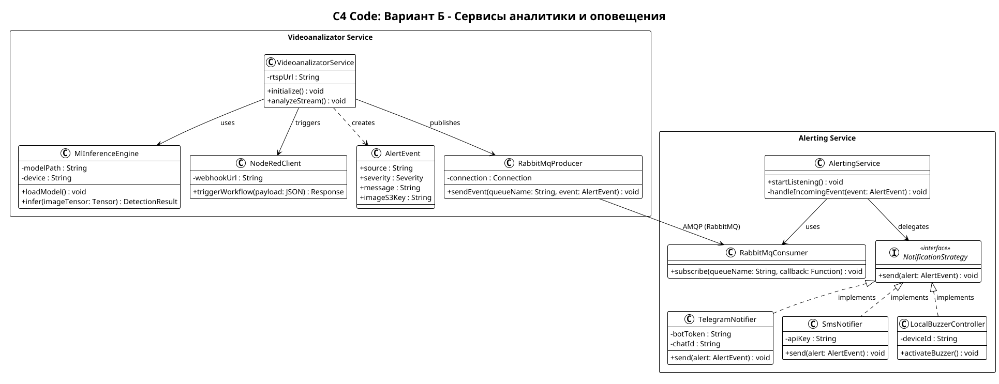

# ADR-002: Выбор архитектурного паттерна (Альтернативное решение «Централизованное» — Вариант Б)

**Статус:** ❌ Отклонено   
**Участники:** Архитектурный комитет, Product Owner, Tech Lead  
**Дата:** 2026-11-14

## 1. Контекст и проблема

«АгроТех Х» — агрохолдинг, занимающаяся свиноводством и выращиваением различных культур, имеет 150 тепличных комплексов
по всей стране. IT-ландшафт компании формировался постепенно и содержит как достаточно современные, так и совсем
устаревшие технологии, от которых постепенно отказываются. По мере развития IoT компания пробует различные датчики и
системы в своей работе.

Сейчас перед компанией стоит задача — повысить эффективность в сфере животноводства и по максимуму автоматизировать
процессы, связанные с кормлением, безопасностью и мониторингом поголовья скота.

Бизнес хочет сделать **MVP платформы мониторинга свиноводческих ферм** — сначала на ограниченном
количестве ферм, потенциально как SaaS-решение в будущем (вне рамок проектной работы).

**Ключевые сложности:**

- системы видеонаблюдения и управления кормлением — от разных производителей, готовые решения
  (PigVision, ALUS, PigTales) не подходят из-за законодательства и стоимости;
- на фермах нестабильный WiFi — нужны альтернативные каналы связи и автономная работа;
- видеоаналитика должна работать в реальном времени, но на каждой ферме допустим только
  один центральный сервер и набор edge-устройств;
- нейросетевую модель предоставляет партнёр.

**Ключевые определения:**

- **Оператор** — сотрудник, который работает с системой: смотрит дашборды, видит оповещения в веб-приложении или
  мобильном, запускает пересчёт поголовья, меняет настройки кормления. Он взаимодействует через API и интерфейс.
- **Дежурный** — сотрудник на месте, который должен физически среагировать: прийти в свинарник, разнять драку, вытащить
  поросёнка.
- **Центральный сервер** (один на всю компанию). Живёт в облаке или дата-центре головного офиса. Его работа — не
  реагировать на ситуации, а накапливать и агрегировать: хранит историю со всех ферм, строит отчёты и дашборды, раздаёт
  обновления нейросетевых моделей, отдаёт метрики в другие системы компании. Если у одной фермы оборвался интернет —
  центр всё равно работает, просто не получает от неё свежих данных.
- **Агент** (сервер на ферме — их много, по одному на ферму) — главный по ферме: собирает данные с камер и датчиков,
  управляет кормушками, хранит локальную историю, а когда связь есть — синхронизирует накопленное с большим центром.
- **Edge-устройства** (их много на ферме) — вычислительные «конечности» при оборудовании: приставка у камеры,
  которая прогоняет видео через нейросеть и понимает «драка — не драка»; контроллер у кормушки, который по команде
  агента выдаёт корм. Они сами почти ничего не решают — они выполняют тяжёлую или срочную работу рядом с оборудованием
  и отчитываются агенту.

## 2. Требования

### **Функциональные требования**

| **№** | **Действующие лица или системы**                                                     | **Use Case**                       | **Описание**                                                                                                                                                           |
|:-----:|:-------------------------------------------------------------------------------------|:-----------------------------------|:-----------------------------------------------------------------------------------------------------------------------------------------------------------------------|
|  UC1  | Система видеонаблюдения, ML, дежурный                                                | Фиксация нештатной ситуации        | Система фиксирует нештатные ситуации (беспокойное поведение, драки, признаки задавливания поросят) и оповещает персонал.                                               |
|  UC2  | Система контроля(датчики), система аналитики, система управления, оператор, дежурный | Управление кормушками и поилками   | Отправка команд на оборудование разных производителей, контроль исполнения, мониторинг телеметрии (объём выдачи, остатки).                                             |
|  UC3  | Система видеонаблюдения, ML, система аналитики, дежурный, оператор                   | Оценка состояния животных          | Оценка внешнего вида и поведения: болезнь, гибель, беспокойство, травмы. Фиксация событий и уведомление ответственных.                                                 |
|  UC4  | Система контроля(датчики), система аналитики, система управления, оператор, дежурный | Состояние воды и запаса корма      | Мониторинг систем фильтрации воды, контроль запасов корма, прогноз расхода и оповещение о дефиците.                                                                    |
|  UC5  | Система видеонаблюдения, ML, система аналитики, дежурный, оператор                   | Пересчёт поголовья                 | Автоматический подсчёт животных по видео, сверка с плановым поголовьем, оповещение о расхождениях.                                                                     |
|  UC6  | Система оповещения, система синхронизации                                            | Оповещения и автономная работа     | При отсутствии интернета система локально оповещает дежурного на ферме; после восстановления связи агенты синхронизируются с центром (допустима задержка до 10 минут). |
|  UC7  | Пользователи, веб-приложение, мобильное приложение                                   | Аутентификация, авторизация и роли | Разделение ролей (оператор, дежурный, ветеринар, администратор), современные механизмы аутентификации, API для веб- и мобильных приложений.                            |

### **Нефункциональные требования**

| **№**  | **Требование**                                                                                                                                                           |
|:------:|:-------------------------------------------------------------------------------------------------------------------------------------------------------------------------|
| **U**  | **Удобство использования (Usability)**                                                                                                                                   |
|   U1   | Работа через мобильное или веб-приложение.                                                                                                                               |
| **R**  | **Надежность (Reliability)**                                                                                                                                             |
|   R1   | Отказоустойчивость 99,95%.                                                                                                                                               |
|   R2   | Автономная работа фермы при отсутствии интернета, синхронизация после восстановления связи (допустимая задержка до 10 минут).                                            |
|   R3   | При восстановлении связи должна выполняться автоматическая синхронизация данных с центральным сервером, включая события и метрики.                                       |
|   R4   | Автоматическая отправка уведомлений персоналу на местах (механики, фермеры).                                                                                             |
| **P**  | **Производительность (Performance)**                                                                                                                                     |
|   P1   | Оповещение о зафиксированной нештатной ситуации не более чем за 5 секунд.                                                                                                |
|   P2   | Видеоаналитика реагирует в реальном времени (миллисекунды).                                                                                                              |
|   P3   | Допустимая задержка синхронизации между агентом и центральным сервером до 10 минут.                                                                                      |
| **S**  | **Сопровождаемость (Supportability)**                                                                                                                                    |
|   S1   | Горизонтальное масштабирование: расширение функционала без изменений существующего.                                                                                      |
| **+R** | **Ограничения (Restrictions)**                                                                                                                                           |
|  +R1   | Нейронные сети путают тень животного с самим животным — для MVP не критично.                                                                                             |
|  +R2   | Проблемы с освещением: камеры должны снимать в ночное время.                                                                                                             |
|  +R3   | Сложный трекинг животных из-за схожести особей.                                                                                                                          |
|  +R4   | Схема «центральный сервер — агенты» на фермах, без ограничения количества агентов. На каждой ферме — один центральный сервер (агент) и необходимый набор edge-устройств. |
|  +R5   | Нестабильный WiFi на ферме — нужны альтернативные каналы связи.                                                                                                          |
|  +R6   | Минимизация слепых зон на ферме. Возможно использование камер «рыбий глаз».                                                                                              |

**Ключевыми требованиями являются:**

- Нестабильный интернет (WiFi) на фермах (+R5).
- Жесткие требования к скорости реакции видеоаналитики (миллисекунды, P2) и оповещению дежурного (до 5 секунд, P1).
- Необходимость автономной работы при потере связи с возможностью синхронизации (до 10 минут, R2, R3, P3).
- Ограничение: на каждой ферме допускается только один центральный сервер (агент) и набор edge-устройств (+R4).

## 3. Решение

**Детализация архитектуры**

Рассматривалась гибридная/централизованная архитектура.  
Локальный агент на ферме выполняет роль легкого шлюза (сбор данных, запись видео, базовая телеметрия).   
Основная бизнес-логика, аналитика и оповещения вынесены на центральный сервер или требуют внешних сервисов.

### Детализация на уровне кода:

На ферме: Агент передает данные, пишет в локальные хранилища (Minio, PostgreSQL) для буферизации. Используется IoT
шлюз (Node-RED) для интеграции с внешними системами (кормушки, поилки).

- **VideoanalizatorService (Точка входа)**: Инициализирует сервис, подключается к RTSP-потоку и запускает
бесконечный цикл чтения кадров.
- **MlInferenceEngine (Движок инференса)**: Изолирует логику работы с нейросетью. Загружает веса модели в память (
GPU/CPU) и выполняет инференс (прямой проход) для конкретного тензора.
- **NodeRedClient (Интегратор IoT)**: Специфичный клиент для вызова вебхуков (HTTP) в Node-RED (IoT шлюз). Например,
если модель распознала, что кормушка пуста, этот класс дергает Node-RED, чтобы тот запустил физический мотор
подачи корма.
- **AlertEvent (Модель события)**: Содержит критически важную информацию для дежурного: источник (камера/датчик),
уровень критичности (Info, Warning, Critical), текст сообщения и ссылку на картинку в S3.
- **RabbitMqProducer (Издатель)**: Отвечает за сериализацию AlertEvent в JSON и отправку его в очередь (exchange)
RabbitMQ. Гарантирует, что сообщение не потеряется (использует подтверждения/acknowledgements).

**В облаке (Сервисы аналитики и оповещения):**

VideoanalizatorService инициализирует RTSP-поток, MlInferenceEngine выполняет инференс (на GPU в облаке), NodeRedClient
вызывает вебхуки. При инциденте создается AlertEvent и отправляется через RabbitMqProducer в очередь. AlertingService
читает очередь и с помощью паттерна «Стратегия» ( NotificationStrategy) отправляет уведомления через TelegramNotifier,
SmsNotifier или LocalBuzzerController.

- **AlertingService (Слушатель)**: Бесконечный цикл (воркер), который читает сообщения из RabbitMQ. Он определяет,
  кому и как переслать это оповещение, основываясь на бизнес-правилах (например, ночью отправлять SMS, днем — в
  Telegram).
- **RabbitMqConsumer (Подписчик)**: Инфраструктурный класс, который держит TCP-соединение с RabbitMQ и вызывает
  метод handleIncomingEvent при появлении нового сообщения в очереди.
- **NotificationStrategy (Паттерн "Стратегия")**: Интерфейс, который позволяет динамически менять способ отправки
  уведомлений, не меняя код AlertingService.
- **TelegramNotifier (Реализация)**: Отправляет сообщение через Telegram Bot API (использует токен и chat_id
  дежурного).
- **SmsNotifier (Реализация)**: Интеграция со шлюзом SMS-рассылок (например, Twilio или локальный оператор).
- **LocalBuzzerController (Реализация)**: Отправляет команду на физическое устройство (сирену на ферме) через MQTT
  или HTTP.

## 4. Анализ решения (Trade-offs)

| Критерий                        | Пояснение                                                                                                                                                |
|---------------------------------|----------------------------------------------------------------------------------------------------------------------------------------------------------|
| Автономность (Offline)          | Только запись. Критично: при потере интернета система теряет возможность аналитики и оповещений (остается только запись). Нарушение требований R2, R3.   |
| Задержка реакции                | Высокая (через облако). Видео должно дойти до облака, обработаться и вернуться командой. Задержка может превысить допустимые 5 секунд. Нарушение P1, P2. |
| Требования к Edge               | Низкие. Можно использовать более дешевые устройства (меньше вычислений на месте).                                                                        |
| Приватность видео               | Средняя (передача в облако)                                                                                                                              |
| Сложность Edge                  | Низкая (шлюз + хранилище)                                                                                                                                |
| Сложность Cloud                 | Высокая (аналитика + алертинг)                                                                                                                           |
| Инфраструктура                  | Простота Edge-оборудования. Наличие Node-RED, внешних моделей и отдельных сервисов (Videoanalizator, Alerting) увеличивает количество точек отказа.      |
| Масштабируемость                | Средняя (зависит от нагрузки на облако)                                                                                                                  |
| Обновления и управление логикой | Централизованное. Все обновления и изменения бизнес-логики происходят в одном месте (в облаке).                                                          |
| Трафик                          | Высокие требования к пропускной способности канала (передача сырого видеопотока или его фрагментов в облако). Не соответствует требованию +R5.           |

## 5. Последствия

**✅ Положительные:**

- Упрощенное развертывание на ферме (нет тяжелых вычислений локально).
- Легче обновлять нейросетевые модели (все в одном месте, в облаке).

**❌ Негативные:**

- Система становится критически зависимой от качества связи.
- Высокие риски задержек в обработке данных и доставке алертов.
- Снижение общей отказоустойчивости (R1).
- Значительный рост затрат на трафик и облачные вычисления (GPU в облаке дороже).
- Сложности при масштабировании на 150+ ферм (облако становится узким горлышком).

## 5. Риски и меры по их снижению

**1. Критическая зависимость от связи (нарушение R2).**

**Мера:** Отсутствуют эффективные меры в рамках данного паттерна. Возврат к локальной обработке.

**2. Высокие задержки (Latency) и превышение P1 (5 сек).**

**Мера:** Использование выделенных каналов связи (дорого), агрессивное сжатие видео (влияет на качество работы ML).

**3. Перегрузка каналов связи (+R5).**

**Мера:** Передача только «подозрительных» кадров. Требует разработки сложной логики на Edge для предварительного
отсева, что частично возвращает нас к архитектуре Варианта А.

## 6. Принятое решение

Вариант Б отклонен.

**Обоснование:** Данный вариант не удовлетворяет критическим требованиям надежности (R2, R3) и производительности (P1,
P2). Невозможность мгновенно реагировать на инциденты на месте (дежурным на ферме) и полная зависимость от нестабильного
интернета (+R5) делают его неприемлемым для системы мониторинга жизнеобеспечения животных. Выбран Вариант А (
Edge-first).