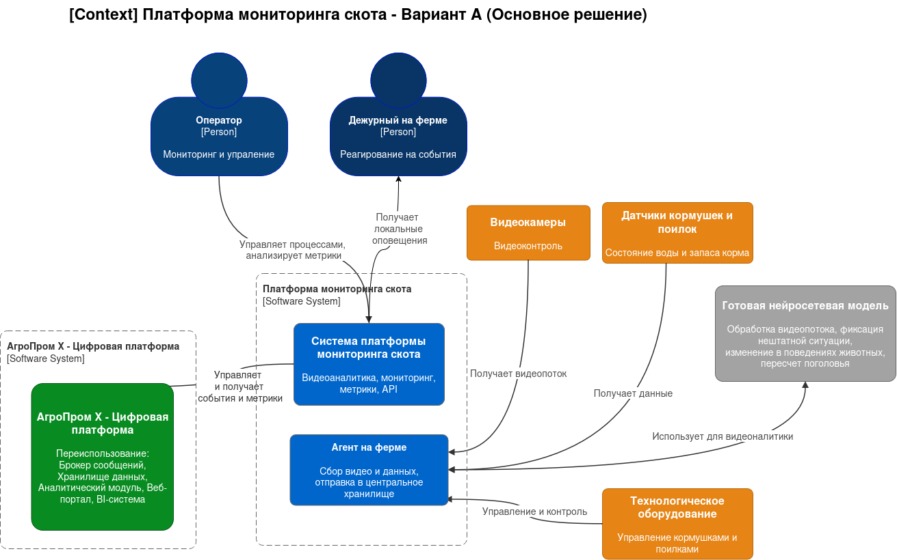
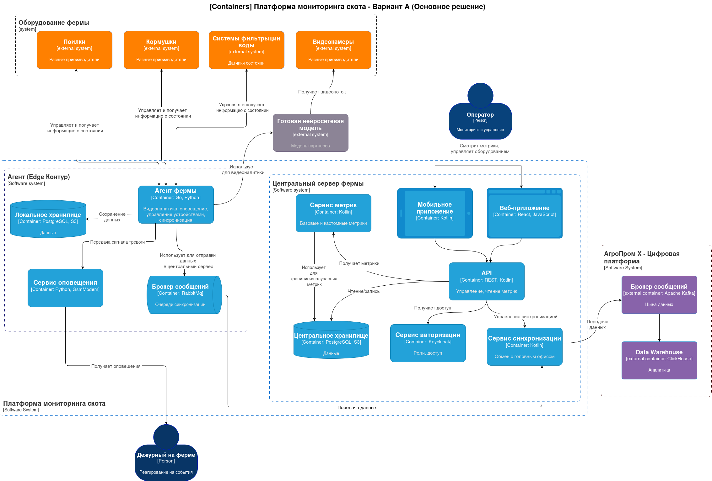
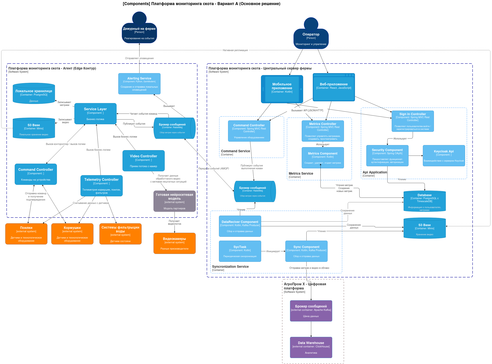
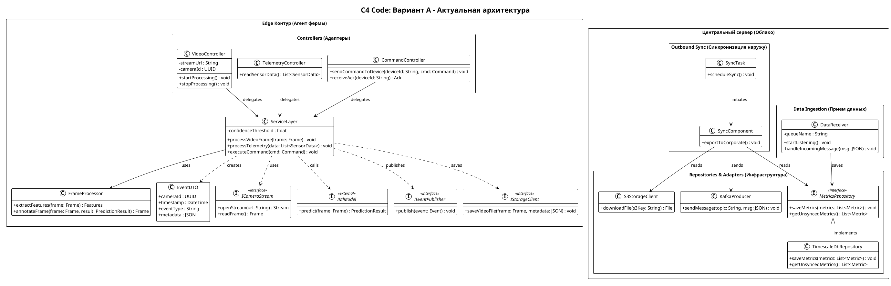

# ADR-001: Выбор архитектурного паттерна (Основное решение «Edge-first» — Вариант А)

**Статус:** ✅ Принято  
**Участники:** Архитектурный комитет, Product Owner, Tech Lead  
**Дата:** 2026-11-14

## 1. Контекст и проблема

«АгроТех Х» — агрохолдинг, занимающаяся свиноводством и выращиваением различных культур, имеет 150 тепличных комплексов
по всей стране. IT-ландшафт компании формировался постепенно и содержит как достаточно современные, так и совсем
устаревшие технологии, от которых постепенно отказываются. По мере развития IoT компания пробует различные датчики и
системы в своей работе.

Сейчас перед компанией стоит задача — повысить эффективность в сфере животноводства и по максимуму автоматизировать
процессы, связанные с кормлением, безопасностью и мониторингом поголовья скота.

Бизнес хочет сделать **MVP платформы мониторинга свиноводческих ферм** — сначала на ограниченном
количестве ферм, потенциально как SaaS-решение в будущем (вне рамок проектной работы).

**Ключевые сложности:**

- системы видеонаблюдения и управления кормлением — от разных производителей, готовые решения
  (PigVision, ALUS, PigTales) не подходят из-за законодательства и стоимости;
- на фермах нестабильный WiFi — нужны альтернативные каналы связи и автономная работа;
- видеоаналитика должна работать в реальном времени, но на каждой ферме допустим только
  один центральный сервер и набор edge-устройств;
- нейросетевую модель предоставляет партнёр.

**Ключевые определения:**

- **Оператор** — сотрудник, который работает с системой: смотрит дашборды, видит оповещения в веб-приложении или
  мобильном, запускает пересчёт поголовья, меняет настройки кормления. Он взаимодействует через API и интерфейс.
- **Дежурный** — сотрудник на месте, который должен физически среагировать: прийти в свинарник, разнять драку, вытащить
  поросёнка.
- **Центральный сервер** (один на всю компанию). Живёт в облаке или дата-центре головного офиса. Его работа — не
  реагировать на ситуации, а накапливать и агрегировать: хранит историю со всех ферм, строит отчёты и дашборды, раздаёт
  обновления нейросетевых моделей, отдаёт метрики в другие системы компании. Если у одной фермы оборвался интернет —
  центр всё равно работает, просто не получает от неё свежих данных.
- **Агент** (сервер на ферме — их много, по одному на ферму) — главный по ферме: собирает данные с камер и датчиков,
  управляет кормушками, хранит локальную историю, а когда связь есть — синхронизирует накопленное с большим центром.
- **Edge-устройства** (их много на ферме) — вычислительные «конечности» при оборудовании: приставка у камеры,
  которая прогоняет видео через нейросеть и понимает «драка — не драка»; контроллер у кормушки, который по команде
  агента выдаёт корм. Они сами почти ничего не решают — они выполняют тяжёлую или срочную работу рядом с оборудованием
  и отчитываются агенту.

## 2. Требования

### **Функциональные требования**

| **№** | **Действующие лица или системы**                                                     | **Use Case**                       | **Описание**                                                                                                                                                           |
|:-----:|:-------------------------------------------------------------------------------------|:-----------------------------------|:-----------------------------------------------------------------------------------------------------------------------------------------------------------------------|
|  UC1  | Система видеонаблюдения, ML, дежурный                                                | Фиксация нештатной ситуации        | Система фиксирует нештатные ситуации (беспокойное поведение, драки, признаки задавливания поросят) и оповещает персонал.                                               |
|  UC2  | Система контроля(датчики), система аналитики, система управления, оператор, дежурный | Управление кормушками и поилками   | Отправка команд на оборудование разных производителей, контроль исполнения, мониторинг телеметрии (объём выдачи, остатки).                                             |
|  UC3  | Система видеонаблюдения, ML, система аналитики, дежурный, оператор                   | Оценка состояния животных          | Оценка внешнего вида и поведения: болезнь, гибель, беспокойство, травмы. Фиксация событий и уведомление ответственных.                                                 |
|  UC4  | Система контроля(датчики), система аналитики, система управления, оператор, дежурный | Состояние воды и запаса корма      | Мониторинг систем фильтрации воды, контроль запасов корма, прогноз расхода и оповещение о дефиците.                                                                    |
|  UC5  | Система видеонаблюдения, ML, система аналитики, дежурный, оператор                   | Пересчёт поголовья                 | Автоматический подсчёт животных по видео, сверка с плановым поголовьем, оповещение о расхождениях.                                                                     |
|  UC6  | Система оповещения, система синхронизации                                            | Оповещения и автономная работа     | При отсутствии интернета система локально оповещает дежурного на ферме; после восстановления связи агенты синхронизируются с центром (допустима задержка до 10 минут). |
|  UC7  | Пользователи, веб-приложение, мобильное приложение                                   | Аутентификация, авторизация и роли | Разделение ролей (оператор, дежурный, ветеринар, администратор), современные механизмы аутентификации, API для веб- и мобильных приложений.                            |

### **Нефункциональные требования**

| **№**  | **Требование**                                                                                                                                                           |
|:------:|:-------------------------------------------------------------------------------------------------------------------------------------------------------------------------|
| **U**  | **Удобство использования (Usability)**                                                                                                                                   |
|   U1   | Работа через мобильное или веб-приложение.                                                                                                                               |
| **R**  | **Надежность (Reliability)**                                                                                                                                             |
|   R1   | Отказоустойчивость 99,95%.                                                                                                                                               |
|   R2   | Автономная работа фермы при отсутствии интернета, синхронизация после восстановления связи (допустимая задержка до 10 минут).                                            |
|   R3   | При восстановлении связи должна выполняться автоматическая синхронизация данных с центральным сервером, включая события и метрики.                                       |
|   R4   | Автоматическая отправка уведомлений персоналу на местах (механики, фермеры).                                                                                             |
| **P**  | **Производительность (Performance)**                                                                                                                                     |
|   P1   | Оповещение о зафиксированной нештатной ситуации не более чем за 5 секунд.                                                                                                |
|   P2   | Видеоаналитика реагирует в реальном времени (миллисекунды).                                                                                                              |
|   P3   | Допустимая задержка синхронизации между агентом и центральным сервером до 10 минут.                                                                                      |
| **S**  | **Сопровождаемость (Supportability)**                                                                                                                                    |
|   S1   | Горизонтальное масштабирование: расширение функционала без изменений существующего.                                                                                      |
| **+R** | **Ограничения (Restrictions)**                                                                                                                                           |
|  +R1   | Нейронные сети путают тень животного с самим животным — для MVP не критично.                                                                                             |
|  +R2   | Проблемы с освещением: камеры должны снимать в ночное время.                                                                                                             |
|  +R3   | Сложный трекинг животных из-за схожести особей.                                                                                                                          |
|  +R4   | Схема «центральный сервер — агенты» на фермах, без ограничения количества агентов. На каждой ферме — один центральный сервер (агент) и необходимый набор edge-устройств. |
|  +R5   | Нестабильный WiFi на ферме — нужны альтернативные каналы связи.                                                                                                          |
|  +R6   | Минимизация слепых зон на ферме. Возможно использование камер «рыбий глаз».                                                                                              |

**Ключевыми требованиями являются:**

- Нестабильный интернет (WiFi) на фермах (+R5).
- Жесткие требования к скорости реакции видеоаналитики (миллисекунды, P2) и оповещению дежурного (до 5 секунд, P1).
- Необходимость автономной работы при потере связи с возможностью синхронизации (до 10 минут, R2, R3, P3).
- Ограничение: на каждой ферме допускается только один центральный сервер (агент) и набор edge-устройств (+R4).

## 3. Решение

**_Выбрана распределенная архитектура «Edge-first» (Периферийные вычисления)._**

**Система разделена на два контура:**

- **Агент фермы (Edge Контур)**: Выполняет сбор данных, локальную видеоаналитику, управление оборудованием, кэширование
  и алертинг.
- **Центральный сервер (Облако/ДЦ)**: Выполняет агрегацию данных со всех ферм, долгосрочное хранение, предоставление API
  для веб/мобильных приложений и аналитику.

**Гибридная модель синхронизации данных:**
Для обеспечения высокой скорости работы и минимизации трафика используется гибридный подход:

1. **Push (События и метрики в реальном времени)**: Service Layer на ферме публикует события в локальный Брокер
   сообщений (RabbitMQ). Локальный брокер, используя плагин федерации, передает события в облачный Брокер сообщений.
   Облачный DataReceiver Component вычитывает их и сохраняет в центральную БД. Это гарантирует доставку данных даже при
   кратковременных обрывах связи.
2. **Нативная репликация (Тяжелые данные)**: Для видеофайлов (MinIO) и исторических таблиц (PostgreSQL) используется
   механизм репликации на уровне инфраструктуры. Видео синхронизируется через Bucket Replication, а метрики — через
   логическую/физическую репликацию СУБД. Это исключает необходимость писать сложные скрипты для перекачки гигабайт
   данных.
3. **Исходящая синхронизация (В корпоративный контур)**: В центральном сервере SyncTask (по расписанию) инициирует
   SyncComponent, который читает накопленные данные из центральной Database и S3 Base и отправляет их в АгроПром Х (
   Kafka -> ClickHouse).

### Детализация на уровне кода (C4):

**Edge (Обработка видео)**:

VideoController (оркестратор) управляет потоком через ICameraStream. Кадры (Frame) передаются в FrameProcessor (
предобработка) и IMlModel (внешний интерфейс нейросети партнера). При обнаружении события создается DTO VideoEvent,
который публикуется через IEventPublisher в брокер.

- **VideoController (Оркестратор)**: Главный класс компонента. Он не занимается обработкой пикселей. Его задача —
  управлять жизненным циклом: открыть поток с камеры (ICameraStream), передать кадры в обработчик и отправить результат
  в брокер сообщений. Он знает что делать, но не знает как.
- **ICameraStream (Интерфейс)**: Абстракция над видеопотоком. Позволяет легко заменить реальную камеру (RTSP) на
  тестовый видеофайл (MP4) при написании юнит-тестов.
- **IMlModel (Внешний интерфейс)**: Контракт для взаимодействия с «Готовой нейросетевой моделью» партнеров. Сервис не
  зависит от конкретной библиотеки (TensorFlow, PyTorch, ONNX), он просто отправляет кадр и получает результат.
- **FrameProcessor (Утилита/Хелпер)**: Класс, который делает "грязную" работу: предобрабатывает кадр (меняет размер,
  нормализует цвета), извлекает признаки и накладывает bounding boxes (рамки) для сохранения аннотированного видео.
- **VideoEvent (DTO / Data Transfer Object)**: Простой класс-контейнер для передачи данных. В нем нет логики, только
  поля: ID камеры, время, тип события и метаданные.
- **IEventPublisher (Интерфейс)**: Абстракция для отправки событий. В коде это может быть RabbitMQ, Kafka или даже
  простой HTTP-запрос.
- **Frame (Кадр)** — это «сырые» данные. Это просто картинка в памяти. Она живет очень недолго: нейросеть посмотрела на
  кадр, сделала вывод, и кадр сразу удаляется из памяти, чтобы не забивать оперативную память.
- **VideoEvent / AlertEvent (Событие)** — это результат анализа. Это маленький JSON-объект (пара килобайт). Он содержит
  вывод: "В 12:05:03 на камере №3 произошло задавливание свиней". Эти события уже сохраняются в базу данных и передаются по
  сети.

**Cloud (Прием и обработка):**

DataReceiver Component (слушатель очереди) принимает события, валидирует их и сохраняет в Database и S3 Base. SyncTask и
SyncComponent отвечают за отправку агрегированных данных во внешние системы компании (АгроПром Х)

- **DataReceiver Component (Слушатель очереди)**: Инфраструктурный компонент, который подписан на облачный Брокер
  сообщений (RabbitMQ). Он читает входящие события (AlertEvent, VideoEvent), валидирует их схему и сохраняет в
  центральную Database для последующей аналитики.
- **SyncTask (Планировщик)**: Запускает процессы синхронизации по расписанию (Cron). Инициирует работу SyncComponent для
  отправки данных в корпоративный контур.
- **SyncComponent (Экспортер)**: Отвечает за чтение накопленных данных из центральных Database и S3 Base и их отправку
  во внешнюю шину данных (Apache Kafka) для загрузки в Data Warehouse (ClickHouse).
- **MetricsRepository (Интерфейс)**: Абстракция для работы с базой данных метрик.
- **TimescaleDbRepository (Реализация)**: Конкретный класс, который пишет SQL-запросы в TimescaleDB (PostgreSQL).

**Ключевые паттерны, которые здесь использованы (для защиты архитектуры):**

- **Dependency Inversion**: Классы зависят от интерфейсов (ICameraStream, IMlModel), а не от конкретных реализаций.
- **Strategy**: В Alerting Service для выбора способа уведомления (Telegram, SMS, сирена).
- **Repository**: Абстракция работы с базой данных.
- **Message-Driven**: Асинхронное взаимодействие через RabbitMQ для развязки компонентов.

## 4. Анализ решения (Trade-offs)

| Критерий               | Пояснение                                                                                                      |
|------------------------|----------------------------------------------------------------------------------------------------------------|
| Автономность (Offline) | Полная работоспособность (детекция, алертинг, управление) без интернета благодаря локальным БД и RabbitMQ.     |
| Задержка реакции       | Низкая (Видеоаналитика на месте (миллисекунды), оповещение дежурного ≤ 5 сек (P1, P2)).                        |
| Требования к Edge      | Высокие (GPU, память).                                                                                         |
| Приватность видео      | Высокая (не покидает ферму).                                                                                   |
| Сложность Edge         | Высокая (много сервисов).                                                                                      |
| Сложность Cloud        | Средняя (управление + синк).                                                                                   |
| Масштабируемость       | Высокая (стандартный образ агента).                                                                            |
| Обновления             | Сложность обновлений логики на Edge. Требуется тщательное тестирование и поэтапная раскатка через SyncManager. |
| Актуальность данных    | Данные в центральном хранилище могут быть неактуальны до 10 минут (до следующей синхронизации).                |

## 5. Последствия

**✅ Положительные:**

- Мгновенная реакция на события (до 5 секунд).
- Автономная работа при отсутствии связи.
- Независимость ферм друг от друга (сбой на одной не влияет на другие).
- Эффективное использование ресурсов и высокая масштабируемость (S1) за счет стандартного образа агента.

**❌ Негативные:**

- Требуются инвестиции в производительное Edge-оборудование.
- Усложняется процесс CI/CD и тестирования обновлений на периферии.
- Данные в центре могут отставать от реального времени (до 10 минут).

**🔗 Зависимости:**

- Нейросетевая модель партнёра (необходимо обеспечить совместимость с Edge).
- Проработка альтернативных каналов связи (LTE/5G) на этапе внедрения.

## 6. Риски и меры по их снижению

**1. Высокие требования к Edge-оборудованию.**

**Мера:** Пилотное тестирование на ограниченном количестве ферм. Подбор оптимальной конфигурации (GPU, память). Заложить
резерв производительности на 20–30%.

**2. Сложность обновления логики на Edge-устройствах.**

**Мера:** Реализовать поэтапную раскатку обновлений через Sync Component с возможностью отката (rollback). Тестирование
на эталонном стенде, имитирующем ферму.

**3. Задержка синхронизации данных с центром (до 10 минут).**

**Мера:** Уведомить бизнес-пользователей о допустимой задержке. Для критических отчётов предусмотреть механизм запроса
актуальных данных с агента по требованию (on-demand sync).

**4. Нестабильный WiFi и отсутствие альтернативных каналов связи.**

**Мера:** Проработать резервные каналы (LTE/5G-модемы, спутниковая связь). Предусмотреть буферизацию данных на агенте
при длительных обрывах связи.

**5. Раздувание очереди репликации при долгом офлайне.**

**Мера:** Настроить мониторинг размера WAL-логов и дискового пространства на агенте. Предусмотреть политику очистки (
retention policy) для старых видеофайлов на ферме.