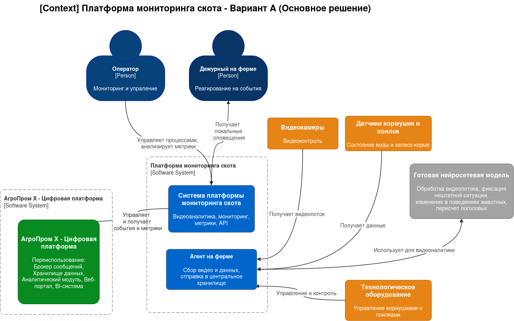
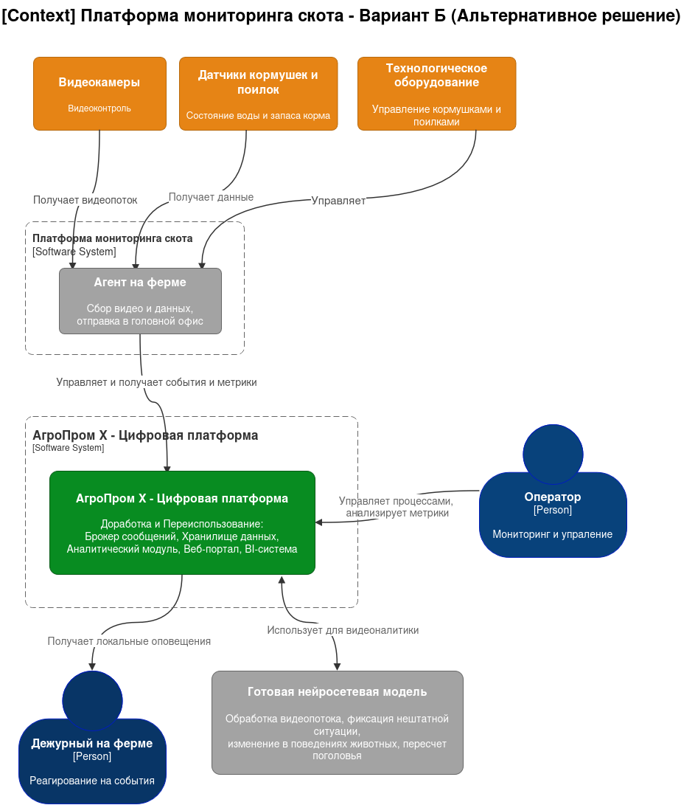

# ADR-001. Разработка вариантов решений

**Статус:** ✅ Принято
**Участники:** Архитектурный комитет, Product Owner, Tech Lead  
**Дата:** 2026-11-14

## 1. Контекст и проблема

«АгроТех Х» — агрохолдинг, занимающаяся свиноводством и выращиваением различных культур, имеет 150 тепличных комплексов
по всей стране. IT-ландшафт компании формировался постепенно и содержит как достаточно современные, так и совсем
устаревшие технологии, от которых постепенно отказываются. По мере развития IoT компания пробует различные датчики и
системы в своей работе.

Сейчас перед компанией стоит задача — повысить эффективность в сфере животноводства и по максимуму автоматизировать
процессы, связанные с кормлением, безопасностью и мониторингом поголовья скота.

Бизнес хочет сделать **MVP платформы мониторинга свиноводческих ферм** — сначала на ограниченном
количестве ферм, потенциально как SaaS-решение в будущем (вне рамок проектной работы).

**Ключевые сложности:**

- системы видеонаблюдения и управления кормлением — от разных производителей, готовые решения
  (PigVision, ALUS, PigTales) не подходят из-за законодательства и стоимости;
- на фермах нестабильный WiFi — нужны альтернативные каналы связи и автономная работа;
- видеоаналитика должна работать в реальном времени, но на каждой ферме допустим только
  один центральный сервер и набор edge-устройств;
- нейросетевую модель предоставляет партнёр.

**Ключевые определения:**

- **Оператор** — сотрудник, который работает с системой: смотрит дашборды, видит оповещения в веб-приложении или
  мобильном, запускает пересчёт поголовья, меняет настройки кормления. Он взаимодействует через API и интерфейс.
- **Дежурный** — сотрудник на месте, который должен физически среагировать: прийти в свинарник, разнять драку, вытащить
  поросёнка.
- **Центральный сервер** (один на всю компанию). Живёт в облаке или дата-центре головного офиса. Его работа — не
  реагировать на ситуации, а накапливать и агрегировать: хранит историю со всех ферм, строит отчёты и дашборды, раздаёт
  обновления нейросетевых моделей, отдаёт метрики в другие системы компании. Если у одной фермы оборвался интернет —
  центр всё равно работает, просто не получает от неё свежих данных.
- **Агент** (сервер на ферме — их много, по одному на ферму) — главный по ферме: собирает данные с камер и датчиков,
  управляет кормушками, хранит локальную историю, а когда связь есть — синхронизирует накопленное с большим центром.
- **Edge-устройства** (их много на ферме) — вычислительные «конечности» при оборудовании: приставка у камеры,
  которая прогоняет видео через нейросеть и понимает «драка — не драка»; контроллер у кормушки, который по команде
  агента выдаёт корм. Они сами почти ничего не решают — они выполняют тяжёлую или срочную работу рядом с оборудованием
  и отчитываются агенту.

## 2. Требования

### **Функциональные требования**

| **№** | **Действующие лица или системы**                                                     | **Use Case**                       | **Описание**                                                                                                                                                           |
|:-----:|:-------------------------------------------------------------------------------------|:-----------------------------------|:-----------------------------------------------------------------------------------------------------------------------------------------------------------------------|
|  UC1  | Система видеонаблюдения, ML, дежурный                                                | Фиксация нештатной ситуации        | Система фиксирует нештатные ситуации (беспокойное поведение, драки, признаки задавливания поросят) и оповещает персонал.                                               |
|  UC2  | Система контроля(датчики), система аналитики, система управления, оператор, дежурный | Управление кормушками и поилками   | Отправка команд на оборудование разных производителей, контроль исполнения, мониторинг телеметрии (объём выдачи, остатки).                                             |
|  UC3  | Система видеонаблюдения, ML, система аналитики, дежурный, оператор                   | Оценка состояния животных          | Оценка внешнего вида и поведения: болезнь, гибель, беспокойство, травмы. Фиксация событий и уведомление ответственных.                                                 |
|  UC4  | Система контроля(датчики), система аналитики, система управления, оператор, дежурный | Состояние воды и запаса корма      | Мониторинг систем фильтрации воды, контроль запасов корма, прогноз расхода и оповещение о дефиците.                                                                    |
|  UC5  | Система видеонаблюдения, ML, система аналитики, дежурный, оператор                   | Пересчёт поголовья                 | Автоматический подсчёт животных по видео, сверка с плановым поголовьем, оповещение о расхождениях.                                                                     |
|  UC6  | Система оповещения, система синхронизации                                            | Оповещения и автономная работа     | При отсутствии интернета система локально оповещает дежурного на ферме; после восстановления связи агенты синхронизируются с центром (допустима задержка до 10 минут). |
|  UC7  | Пользователи, веб-приложение, мобильное приложение                                   | Аутентификация, авторизация и роли | Разделение ролей (оператор, дежурный, ветеринар, администратор), современные механизмы аутентификации, API для веб- и мобильных приложений.                            |

### **Нефункциональные требования**

| **№**  | **Требование**                                                                                                                                                           |
|:------:|:-------------------------------------------------------------------------------------------------------------------------------------------------------------------------|
| **U**  | **Удобство использования (Usability)**                                                                                                                                   |
|   U1   | Работа через мобильное или веб-приложение.                                                                                                                               |
| **R**  | **Надежность (Reliability)**                                                                                                                                             |
|   R1   | Отказоустойчивость 99,95%.                                                                                                                                               |
|   R2   | Автономная работа фермы при отсутствии интернета, синхронизация после восстановления связи (допустимая задержка до 10 минут).                                            |
|   R3   | При восстановлении связи должна выполняться автоматическая синхронизация данных с центральным сервером, включая события и метрики.                                       |
|   R4   | Автоматическая отправка уведомлений персоналу на местах (механики, фермеры).                                                                                             |
| **P**  | **Производительность (Performance)**                                                                                                                                     |
|   P1   | Оповещение о зафиксированной нештатной ситуации не более чем за 5 секунд.                                                                                                |
|   P2   | Видеоаналитика реагирует в реальном времени (миллисекунды).                                                                                                              |
|   P3   | Допустимая задержка синхронизации между агентом и центральным сервером до 10 минут.                                                                                      |
| **S**  | **Сопровождаемость (Supportability)**                                                                                                                                    |
|   S1   | Горизонтальное масштабирование: расширение функционала без изменений существующего.                                                                                      |
| **+R** | **Ограничения (Restrictions)**                                                                                                                                           |
|  +R1   | Нейронные сети путают тень животного с самим животным — для MVP не критично.                                                                                             |
|  +R2   | Проблемы с освещением: камеры должны снимать в ночное время.                                                                                                             |
|  +R3   | Сложный трекинг животных из-за схожести особей.                                                                                                                          |
|  +R4   | Схема «центральный сервер — агенты» на фермах, без ограничения количества агентов. На каждой ферме — один центральный сервер (агент) и необходимый набор edge-устройств. |
|  +R5   | Нестабильный WiFi на ферме — нужны альтернативные каналы связи.                                                                                                          |
|  +R6   | Минимизация слепых зон на ферме. Возможно использование камер «рыбий глаз».                                                                                              |

# 3. Решение

### **Основное решение (распределенная архитектура)**

Система датчиков и система видеонаблюдения, находящиеся на ферме, отправляют показатели на агент фермы.

**На агенте предусматривается:**

- сохранение показателей и видео.
- обработка видеопотока с помощью нейросетевой модели
- обработка показателей с датчиков

В случае выявления внештатных ситуаций, отклонений в состояниях животных, несрабатывания каких-либо механизмов на ферме,
истощении запасов корма и воды с помощью сервиса оповещения производится оповещение дежурного.

Все показатели синхронизируются с центральным сервером.

Показатели выводятся на дашбордах.

**Компоненты системы:**

- Локальный агент на ферме
- Edge-устройства для обработки данных
- Центральный сервер для агрегации

**Аргументация:**

| Критерий                   | Обоснование                                                                                                                                                                                                     |
|----------------------------|-----------------------------------------------------------------------------------------------------------------------------------------------------------------------------------------------------------------|
| Автономность (R2, R3)      | Локальный Service Layer и Alerting Service обеспечивают полную работоспособность (детекция, оповещение, управление) без интернета. Данные накапливаются локально и синхронизируются после восстановления связи. |
| Время реакции (P1, P2)     | Видеоаналитика и алертинг выполняются на месте (миллисекунды), что гарантирует оповещение за ≤5 секунд. В централизованной архитектуре это невозможно из-за задержек сети.                                      |
| Приватность и трафик (+R5) | Видео не покидает периметр фермы, в облако уходят только метаданные и агрегированная телеметрия. Экономия канала связи при нестабильном WiFi.                                                                   |
| Отказоустойчивость (R1)    | Независимость ферм друг от друга: сбой на одной ферме не влияет на другие. Центральный сервер продолжает работать при обрыве связи с отдельной фермой.                                                          |
| Масштабируемость (S1)      | Стандартный образ агента упрощает добавление новых ферм. Горизонтальное масштабирование без изменений существующего функционала.                                                                                |

**Последствия**

_Положительные:_
- Мгновенная реакция на события (до 5 секунд);
- Автономная работа при отсутствии связи;
- Независимость ферм друг от друга;
- Эффективное использование ресурсов;
- Масштабируемость.

_Негативные:_
- Требуются более производительные Edge-устройства (GPU для нейросетей, память/CPU для локальных БД и сервисов);
- Сложность обновления логики на Edge-устройствах (требует тщательного тестирования через Sync Component);
- Данные в центральном хранилище могут быть неактуальны до момента следующей синхронизации (до 10 минут).

_Зависимости:_
- Нейросетевая модель предоставляется партнёром — необходимо обеспечить совместимость с Edge-устройствами;
- Альтернативные каналы связи (при нестабильном WiFi) — требуется проработка на этапе внедрения.

### **Альтернативное решение (централизованная архитектура)**

Агент на ферме собирает все показания датчиков и виде с камер и отправляет на центральный сервер.

На центральном сервере происходит обработках данных, вывод показателей на дашборд, выявление случаев оповещения с
помощью ML и отправка уведомлений дежурного в случае фиксации таковых.

Компоненты системы:

- Центральный сервер как единственный обработчик
- Агенты только для сбора данных
- Каналы связи для передачи всех данных

Плюсы:

- Упрощенное управление системой
- Единая точка обработки данных
- Меньшие требования к оборудованию на фермах

Минусы:

- Зависимость от качества связи
- Риск задержек в обработке данных
- Снижение отказоустойчивости
- Проблемы с соблюдением требований по времени реакции
- Сложности при масштабировании

## 4. Принятое решение

Выбрано основное решение (Вариант А).

**Обоснование:**
Вариант А является единственным решением, которое полностью удовлетворяет критическим требованиям надежности (R2, R3) и производительности (P1). Возможность работать без интернета и мгновенно реагировать на инциденты на месте (дежурным на ферме) является приоритетом для системы мониторинга жизнеобеспечения животных. Разделение на «Локальный» и «Центральный» контуры позволяет масштабировать систему (S1) и обеспечивать сохранность данных при любых сбоях связи.

**Ключевые компоненты выбранного решения**
- Агент фермы (Edge): Реализует видеоаналитику, управление устройствами и буферизацию данных.
- Локальное хранилище (PostgreSQL): Обеспечивает автономность и хранение очередей событий при обрыве связи.
- Локальный брокер (RabbitMQ): Гарантирует доставку сообщений внутри фермы и надежную очередь на синхронизацию.
- Сервис синхронизации: Отвечает за двусторонний обмен данными между фермой и центральной платформой (передача метрик, событий, обновлений конфигураций).
- Центральный сервер: Агрегирует данные со всех ферм, предоставляет доступ операторам через Web/Mobile, выполняет долгосрочную аналитику.

## 5. Риски

- **Высокие требования к Edge-оборудованию**

   **Меры**: Провести пилотное тестирование на ограниченном количестве ферм, подобрать оптимальную конфигурацию (GPU, память). Заложить резерв производительности на 20–30%.

- **Сложность обновления логики на Edge-устройствах**

   **Меры**: Реализовать поэтапную раскатку обновлений через Sync Component с возможностью отката. Проводить тестирование на эталонном стенде, имитирующем ферму.

- **Задержка синхронизации данных с центром (до 10 минут)**

   **Меры**: Уведомить бизнес-пользователей о допустимой задержке. Для критических отчётов предусмотреть механизм запроса актуальных данных с агента по требованию (on-demand sync).

- **Нестабильный WiFi и отсутствие альтернативных каналов связи**

   **Меры**: На этапе внедрения проработать резервные каналы (LTE/5G-модемы, спутниковая связь). Предусмотреть буферизацию данных на агенте при длительных обрывах связи.

- **Ограничения нейросетевой модели (тени, освещение, схожесть особей)**

   **Меры**: Для MVP зафиксировать ограничения в документации (+R1, +R2, +R3). Предусмотреть механизм ручной верификации событий оператором. Планировать дообучение модели на реальных данных ферм.
