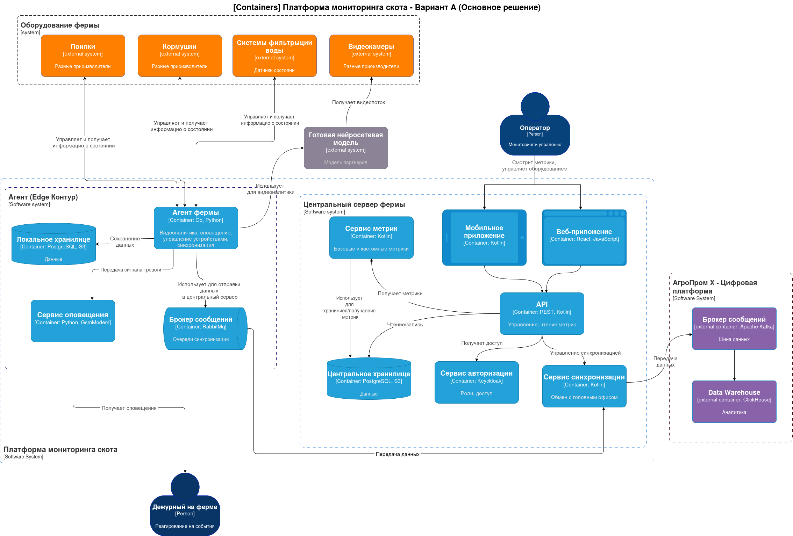
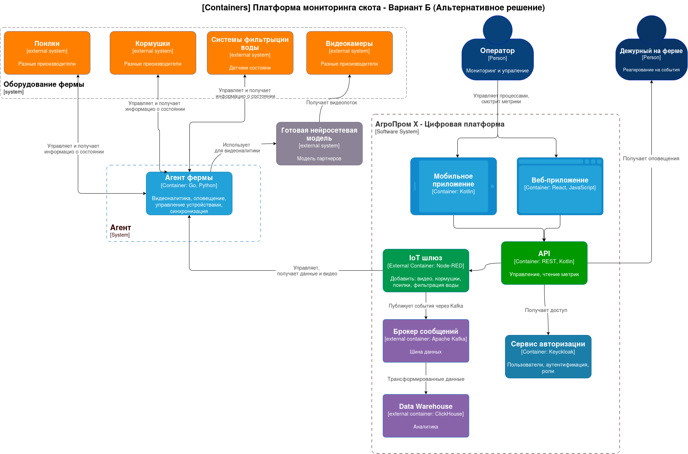

# ADR-002. Проработка высокоуровневого видения решений

**Статус:** ✅ Принято  
**Участники:** Архитектурный комитет, Product Owner, Tech Lead  
**Дата:** 2026-11-14

## 1. Требования
### Функциональные требования

<table>
  <caption>Функциональные требования</caption>
  <thead>
    <tr>
      <th scope="col">№</th>
      <th scope="col">Действующие лица или системы</th>
      <th scope="col">Use Case</th>
      <th scope="col">Описание</th>
    </tr>
  </thead>
  <tbody>
    <tr>
      <th scope="row">UC-01</th>
      <td>Система видеонаблюдения, ML, дежурный</td>
      <td>Фиксация нештатной ситуации</td>
      <td></td>
    </tr>
    <tr>
      <th scope="row">UC-02</th>
      <td>Система контроля (датчики), система аналитики, система управления, оператор, дежурный</td>
      <td>Управление кормушками и поилками</td>
      <td></td>
    </tr>
    <tr>
      <th scope="row">UC-03</th>
      <td>Система видеонаблюдения, ML, система аналитики, дежурный, оператор</td>
      <td>Оценка состояния животных</td>
      <td></td>
    </tr>
    <tr>
      <th scope="row">UC-04</th>
      <td>Система контроля (датчики), система аналитики, система управления, оператор, дежурный</td>
      <td>Состояние воды и запаса корма</td>
      <td></td>
    </tr>
    <tr>
      <th scope="row">UC-05</th>
      <td>Система видеонаблюдения, ML, система аналитики, дежурный, оператор</td>
      <td>Пересчёт поголовья</td>
      <td></td>
    </tr>
    <tr>
      <th scope="row">UC-06</th>
      <td>Система оповещения, система синхронизации</td>
      <td>Оповещения и автономная работа</td>
      <td></td>
    </tr>
    <tr>
      <th scope="row">UC-07</th>
      <td>Пользователи, веб-приложение, мобильное приложение</td>
      <td>Аутентификация, авторизация и роли</td>
      <td></td>
    </tr>
  </tbody>
</table>

### Нефункциональные требования

<table>
  <caption>Нефункциональные требования</caption>
  <thead>
    <tr>
      <th scope="col" width="10%">Категория</th>
      <th scope="col" width="10%">№</th>
      <th scope="col" width="80%">Требование</th>
    </tr>
  </thead>
  <tbody>
    <!-- Usability -->
    <tr>
      <th scope="rowgroup" rowspan="2">U</th>
      <td colspan="2" style="text-align: left; font-weight: bold;">Удобство использования (Usability)</td>
    </tr>
    <tr>
      <td>U1</td>
      <td style="text-align: left;">Работа через мобильное или веб-приложение.</td>
    </tr>
    <tr>
      <th scope="rowgroup" rowspan="5">R</th>
      <td colspan="2" style="text-align: left; font-weight: bold;">Надёжность (Reliability)</td>
    </tr>
    <tr>
      <td>R1</td>
      <td style="text-align: left;">Отказоустойчивость 99,95%.</td>
    </tr>
    <tr>
      <td>R2</td>
      <td style="text-align: left;">Автономная работа фермы при отсутствии интернета, синхронизация после восстановления связи (допустимая задержка до 10 минут).</td>
    </tr>
    <tr>
      <td>R3</td>
      <td style="text-align: left;">При восстановлении связи должна выполняться автоматическая синхронизация данных с центральным сервером, включая события и метрики.</td>
    </tr>
    <tr>
      <td>R4</td>
      <td style="text-align: left;">Автоматическая отправка уведомлений персоналу на местах (механики, фермеры).</td>
    </tr>
    <tr>
      <th scope="rowgroup" rowspan="4">P</th>
      <td colspan="2" style="text-align: left; font-weight: bold;">Производительность (Performance)</td>
    </tr>
    <tr>
      <td>P1</td>
      <td style="text-align: left;">Оповещение о зафиксированной нештатной ситуации не более чем за 5 секунд.</td>
    </tr>
    <tr>
      <td>P2</td>
      <td style="text-align: left;">Видеоаналитика реагирует в реальном времени (миллисекунды).</td>
    </tr>
    <tr>
      <td>P3</td>
      <td style="text-align: left;">Допустимая задержка синхронизации между агентом и центральным сервером до 10 минут.</td>
    </tr>
    <tr>
      <th scope="rowgroup" rowspan="2">S</th>
      <td colspan="2" style="text-align: left; font-weight: bold;">Сопровождаемость (Supportability)</td>
    </tr>
    <tr>
      <td>S1</td>
      <td style="text-align: left;">Горизонтальное масштабирование: расширение функционала без изменений существующего.</td>
    </tr>
    <tr>
      <th scope="rowgroup" rowspan="7">+R</th>
      <td colspan="2" style="text-align: left; font-weight: bold;">Ограничения (Restrictions)</td>
    </tr>
    <tr>
      <td>+R1</td>
      <td style="text-align: left;">Нейронные сети путают тень животного с самим животным — для MVP не критично.</td>
    </tr>
    <tr>
      <td>+R2</td>
      <td style="text-align: left;">Проблемы с освещением: камеры должны снимать в ночное время.</td>
    </tr>
    <tr>
      <td>+R3</td>
      <td style="text-align: left;">Сложный трекинг животных из-за схожести особей.</td>
    </tr>
    <tr>
      <td>+R4</td>
      <td style="text-align: left;">Схема «центральный сервер — агенты» на фермах, без ограничения количества агентов. На каждой ферме — один центральный сервер (агент) и необходимый набор edge-устройств.</td>
    </tr>
    <tr>
      <td>+R5</td>
      <td style="text-align: left;">Нестабильный WiFi на ферме — нужны альтернативные каналы связи.</td>
    </tr>
    <tr>
      <td>+R6</td>
      <td style="text-align: left;">Минимизация слепых зон на ферме. Возможно использование камер «рыбий глаз».</td>
    </tr>
  </tbody>
</table>

## Контекст и ограничения 
В соответствии с нефункциональными требованиями, ключевыми вызовами для системы являются:
- R2, R3, P3: Необходимость автономной работы при отсутствии интернета с последующей синхронизацией (задержка до 10 мин).
- P1, P2: Жесткие требования к скорости реакции видеоаналитики (миллисекунды) и оповещению (до 5 сек).
- +R5: Нестабильный WiFi на ферме.

### Основное решение — «Edge-first (Периферийные вычисления)»

**Суть:** Разделение системы на локальный Edge-контур (на ферме) и Центральный сервер. Тяжелая видеоаналитика выполняется локально агентом на ферме.

**Последствия:**

**_Положительные:_**
- Автономность (R2, R3): Агент фермы содержит локальное хранилище (PostgreSQL) и брокер сообщений (RabbitMQ). Даже при полном отключении интернета система продолжает фиксировать события, управлять оборудованием и копить данные. Синхронизация произойдет автоматически при восстановлении связи.
- Производительность (P1, P2): Видеоаналитика выполняется локально (Go/Python), что обеспечивает реакцию в миллисекундах. Дежурный получает оповещения мгновенно через локальную сеть.
- Устойчивость к сети (+R5): Отсутствует зависимость от качества WiFi для работы критических функций.

_**Минусы / Риски:**_
- Более сложная архитектура: требуется поддержка двух контуров (локального и центрального) и механизмов синхронизации.
- Требуются вычислительные мощности непосредственно на ферме (Edge-устройства).

**_Зависимости:**_
- Нейросетевая модель предоставляется партнёром — необходимо обеспечить совместимость с Edge-устройствами.
- Альтернативные каналы связи (при нестабильном WiFi) — требуется проработка на этапе внедрения.
- 
### Альтернативное решение — «Централизованный»

Суть: Легковесный агент на ферме, который передает видеопоток и данные на центральный IoT-шлюз в облаке, где происходит основная обработка.

**Плюсы:**
- Упрощенное развертывание на ферме (нет тяжелых вычислений локально).
- Легче обновлять нейросетевые модели (все в одном месте).

**Минусы / Риски:**
- Критично: При падении интернета (нарушение R2) система теряет возможность видеоаналитики, так как поток идет в облако.
- Высокие требования к пропускной способности канала (передача сырого видео с камер).
- Задержка (Latency) при анализе и оповещении может превысить 5 секунд (P1) из-за сети.
- Не соответствует требованию +R5 (нестабильный WiFi).
