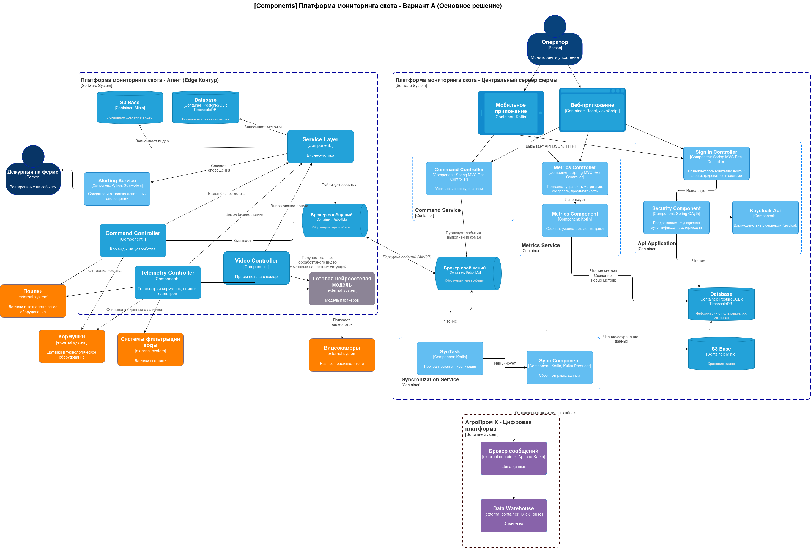
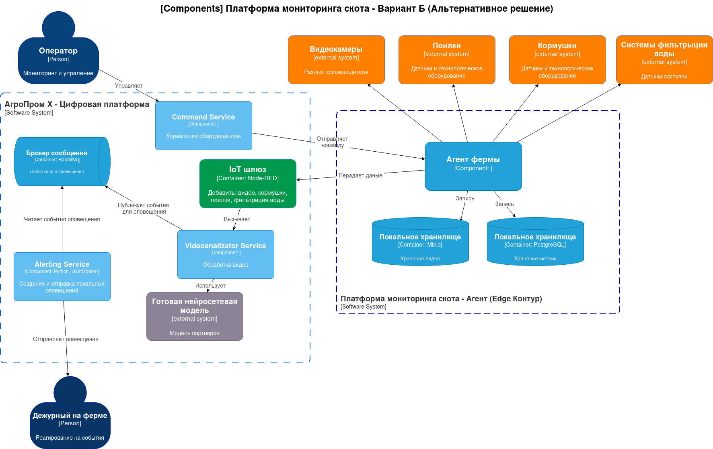

# ADR-003: Проработка высокоуровневого видения решений

**Статус:** ✅ Принято  
**Участники:** Архитектурный комитет, Product Owner, Tech Lead  
**Дата:** 2026-11-14

### Основное решение — «Edge-first (Периферийные вычисления)»

**Суть:** Локальный агент (Edge Контур) берет на себя максимум задач: бизнес-логику, видеоаналитику, алертинг,
кэширование и синхронизацию.
**Плюсы:**

- Высокая автономность: Система полноценно работает (детекция, алертинг, управление) без интернета.
- Приватность: Видео не покидает периметр фермы, в облако уходят только метаданные.
- Экономия трафика: Передается только агрегированная телеметрия и метаданные.
- Низкая задержка (Latency): Решения принимаются на месте.

**Минусы:**

- Требовательность к оборудованию: Нужны производительные Edge-устройства (GPU для нейросетей, достаточно памяти/CPU для
  БД и сервисов).
- Сложность обновлений: Обновление логики на Edge требует тщательного тестирования (через Sync Component).

Ключевые компоненты (из диаграммы):

***Локально на ферме:***

- Service Layer — ядро бизнес-логики.
- Alerting Service — создание и отправка локальных оповещений.
- Video Controller + Готовая нейросетевая модель — локальная видеоаналитика.
- Telemetry Controller — сбор данных с датчиков.
- Command Controller — управление оборудованием.
- S3 Base (Minio) — локальное хранение видео.
- Database (PostgreSQL + TimescaleDB) — локальное хранение метрик.
- Sync Component — двусторонняя синхронизация с облаком.

***В центральном офисе:***

- Command Service, Metrics Service, Api Application — управление и доступ.
- Sync Component — прием данных.
- Database, S3 Base — централизованное хранение.
- Data Warehouse (ClickHouse) — аналитика.

### Альтернативное решение — «Edge-first (Периферийные вычисления)»

**Суть:** Локальный агент выполняет роль шлюза (сбор данных, запись видео, базовая телеметрия), а основная
бизнес-логика, аналитика и оповещения вынесены на центральный сервер или требуют внешних сервисов.

**Ключевые компоненты (из диаграммы):**

***Локально на ферме:***

- Агент фермы — передает данные, записывает в локальные хранилища.
- Локальное хранилище (Minio, PostgreSQL) — только буферизация.
- IoT шлюз (Node-RED) — добавление внешних систем.
- Videoanalizator Service — обработка видео (вызывает внешнюю нейросетевую модель).

***В центральном офисе (АгроПром Х):***

- Command Service — управление оборудованием (отправляет команды на агент).
- Videoanalizator Service — обработка видео.
- Alerting Service (Python, GemModem) — создание и отправка оповещений.
- Брокер сообщений (RabbitMQ) — обмен событиями.

**Плюсы:**

- Простота Edge-оборудования: Можно использовать более дешевые устройства (меньше вычислений на месте).
- Централизованное управление логикой: Все обновления и изменения бизнес-логики происходят в одном месте (в облаке).

**Минусы:**

- Зависимость от связи: При потере интернета система теряет возможность аналитики и оповещений (остается только запись).
- Задержка (Latency): Видео и данные должны дойти до облака, обработаться и вернуться командой — это медленнее.
- Трафик: Передача видеопотока или его фрагментов в облако для анализа требует широкого канала.
- Сложность инфраструктуры: Наличие Node-RED, внешних моделей и отдельных сервисов (Videoanalizator, Alerting)
  увеличивает количество точек отказа.

### Сравнительный анализ

| Критерий               | Вариант А (Основное)               | Вариант Б (Альтернативное)              |
|------------------------|------------------------------------|-----------------------------------------|
| Автономность (Offline) | Полная                             | Только запись                           |
| Задержка реакции       | Низкая (на месте)                  | Высокая (через облако)                  |
| Требования к Edge      | Высокие (GPU, память)              | Низкие                                  |
| Приватность видео      | Высокая (не покидает ферму)        | Средняя (передача в облако)             |
| Сложность Edge         | Высокая (много сервисов)           | Низкая (шлюз + хранилище)               |
| Сложность Cloud        | Средняя (управление + синк)        | Высокая (аналитика + алертинг)          |
| Масштабируемость       | Высокая (стандартный образ агента) | Средняя (зависит от нагрузки на облако) |
