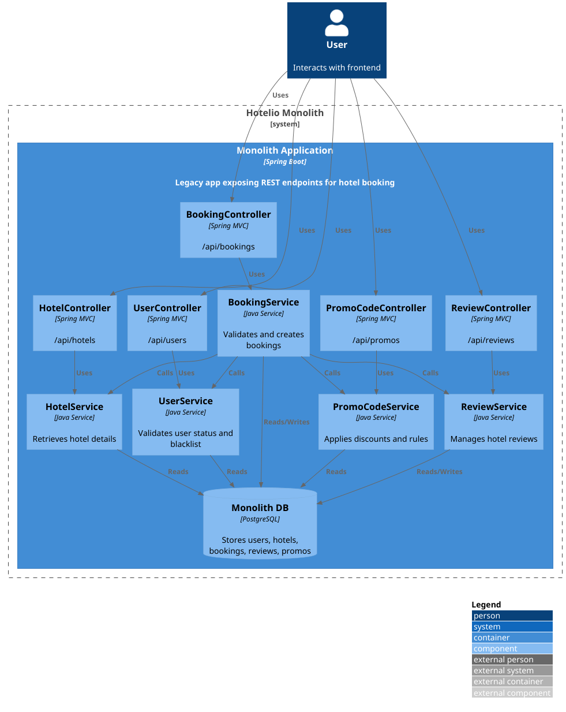
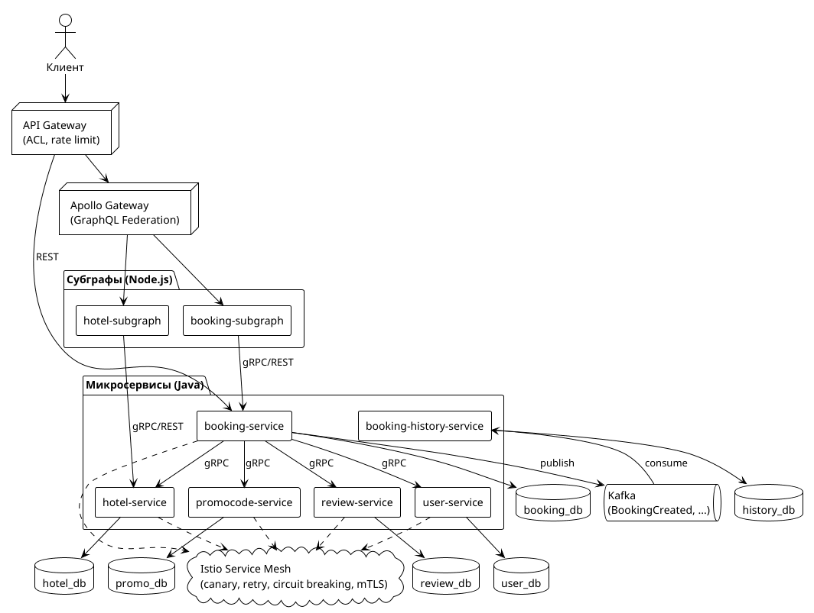
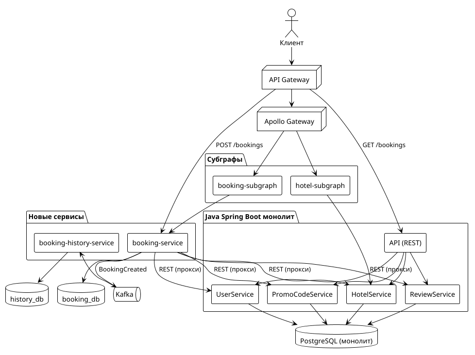
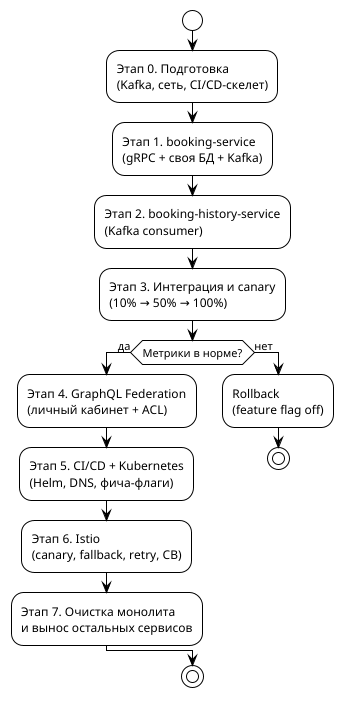
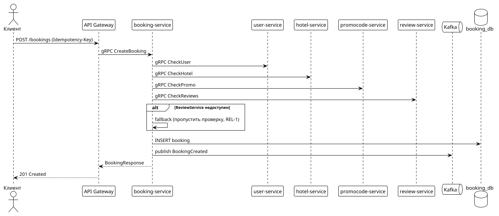

# ADR-001: Поэтапная миграция монолита Hotelio на микросервисы с использованием паттерна Strangler Fig

**Статус:** ✅ Принято | ⚠️ На рассмотрении | ❌ Отклонено    
**Участники:** Архитектур, Продукт-менеджер, Бэкенд-разработчик, Фротенд-разработчк, DevOps-инженер, Тестировщик
**Дата:** 2026-11-19
**Автор:** Лазаренко А.Д.

---

## 1. Контекст

**Hotelio** — онлайн-платформа для бронирования отелей и апартаментов.

**Текущее состояние**: Java Spring Boot монолит, единая PostgreSQL, плотная связанность модулей (BookingService
синхронно вызывает UserService, PromoCodeService, HotelService, ReviewService). Большая нагрузка приходится на поиск и
бронирование жилья.

**Ключевые проблемы**:

- Невозможность независимого масштабирования (при пиковых нагрузках на бронирование страдает весь сервис).
- Высокий риск при деплое (любое изменение требует пересборки и тестирования всего монолита).
- Блокировка команд (все разработчики работают в одной кодовой базе).
- Ограничения для фронтенда (отсутствие BFF, негибкий REST API).
- Единая БД — узкое место для балансировки нагрузки и переезда в облако.

**Ограничения**: штат (2 Java-разработчика, 1 архитектор, 1 DevOps, 1 тестировщик, 1 PM), инфраструктура (Kafka, Docker,
Java Spring Boot, PostgreSQL).

### Текущая архитектура

### Цель

Начать **поэтапный переход** к микросервисной архитектуре, применяя паттерн **Strangler Fig** — выносить по одному
компоненту, оставляя остальной функционал в монолите. Это позволит:

- Упростить масштабирование
- Снизить время выхода фичей
- Повысить отказоустойчивость
- Упростить независимую разработку разных команд

**Промежуточное состояние через 2 месяца** (цель проектной работы):

- Мигрировано несколько сервисов (минимум BookingService + booking-history-service).
- Старые сервисы в монолите не дорабатываются.
- Новая функциональность пишется только в мигрированных сервисах.
- Начато разделение баз для балансировки нагрузки и переезда в облако.

---

## 2. Требования

### Функциональные (FURPS+)

| Категория                | Требование                                                                                                                                                           |
|--------------------------|----------------------------------------------------------------------------------------------------------------------------------------------------------------------|
| **F**unctional           | **Функциональные возможности системы**                                                                                                                               |
| FUNC-1                   | `BookingService` должен обрабатывать создание бронирований: проверять пользователя, отель, промокод, отзывы; вычислять финальную цену и скидку; сохранять результат. |
| FUNC-2                   | `UserService` должен проверять статус пользователя (активен, не в чёрном списке) и возвращать его статус.                                                            |
| FUNC-3                   | `HotelService` должен предоставлять информацию об отелях для валидации бронирования и отображения в интерфейсе.                                                      |
| FUNC-4                   | `PromoCodeService` должен проверять промокоды: действительность, применимость к конкретному пользователю.                                                            |
| FUNC-5                   | `ReviewService` должен отвечать за отзывы и рейтинг отеля; влиять на возможность бронирования при плохой репутации.                                                  |
| FUNC-6                   | Существующие REST-эндпоинты монолита должны продолжать работать без изменений для клиентов и партнёрских каналов (обратная совместимость).                           |
| FUNC-7                   | Система должна обеспечивать личный кабинет: агрегацию данных о бронированиях и отелях через GraphQL (BFF).                                                           |
| FUNC-8                   | Система должна формировать статистику по бронированиям (по пользователям, отелям, дням) асинхронно, без нагрузки на боевую БД.                                       |
| **R**eliability          | **Отказоустойчивость**                                                                                                                                               |
| REL-1                    | Падение `ReviewService` не должно блокировать создание брони (graceful degradation / fallback).                                                                      |
| REL-2                    | Доступность системы бронирования — не ниже 99.9% в месяц.                                                                                                            |
| REL-3                    | RTO при отказе отдельного микросервиса — не более 5 минут (автоматический restart/rollback).                                                                         |
| REL-4                    | RPO для данных бронирований — 0 (синхронная запись в БД сервиса); для статистики — до 5 минут.                                                                       |
| REL-5                    | Создание бронирования должно быть идемпотентным по `idempotency-key`.                                                                                                |
| **P**erformance          | **Производительность**                                                                                                                                               |
| PER-1                    | Независимое масштабирование сервисов, испытывающих сильную нагрузку в пиковые часы.                                                                                  |
| PER-2                    | p95 latency создания бронирования — не более 500 мс (без учёта внешних партнёрских API).                                                                             |
| PER-3                    | Throughput `BookingService` — не менее 100 RPS на 1 реплику при 2 vCPU.                                                                                              |
| PER-4                    | Асинхронная обработка событий Kafka — задержка до появления записи в статистике не более 30 секунд.                                                                  |
| **S**upportability       | **Сопровождаемость**                                                                                                                                                 |
| SUP-1                    | Метрики (Prometheus) и распределённая трассировка (OpenTelemetry) для каждого сервиса.                                                                               |
| SUP-2                    | Обратная совместимость API (versioning, contract tests).                                                                                                             |
| SUP-3                    | Релиз через CI/CD (Kubernetes + Helm) и Rollouts (canary).                                                                                                           |
| SUP-4                    | Централизованное логирование (ELK/Loki) с correlation-id.                                                                                                            |
| SUP-5                    | SLI/SLO для каждого сервиса: latency p95, error rate, saturation.                                                                                                    |
| **+** Design constraints | **Ограничения дизайна**                                                                                                                                              |
| CON-1                    | Стек: Java Spring Boot (сервисы), Node.js (GraphQL-субграфы), Docker, Kafka, PostgreSQL.                                                                             |
| CON-2                    | Развёртывание в Kubernetes (Minikube для локальной разработки).                                                                                                      |
| CON-3                    | Общение между сервисами — gRPC (синхронное) и Kafka (асинхронное).                                                                                                   |
| CON-4                    | Штат ограничен — решение не должно требовать выделенной SRE-команды на этапе миграции.                                                                               |
| CON-5                    | Поэтапная миграция без остановки бизнеса (zero-downtime).                                                                                                            |

---

## 3. Решение (Decision)

### 3.1 Выбор стратегии

Выбран **Strangler Fig** (постепенное «удушение» монолита) вместо **Big Bang** (полное переписывание с нуля):

- снижает риски (каждый шаг обратим);
- позволяет получать ценность постепенно;
- соответствует ограниченному штату (не требует параллельной разработки всего).

### 3.2 Выбор первого модуля для миграции

**BookingService** — потому что:

1. **Ядро бизнеса** — точка входа для создания брони, ключевая ценность платформы.
2. **Высокая нагрузка** — пиковые нагрузки на бронирование деградируют весь монолит.
3. **Сильная связанность** — вынос заставляет явно спроектировать контракты с `UserService`, `HotelService`,
   `PromoCodeService`, `ReviewService`.
4. **Изоляция отказов** — падение `ReviewService` не должно блокировать бронирование (REL-1).
5. **Естественная граница домена** — bounded context «Бронирование» хорошо очерчен.

### 3.3 Целевое состояние (через год)

- Пять микросервисов с собственными БД: `booking-service`, `hotel-service`, `user-service`, `promocode-service`,
  `review-service`, плюс `booking-history-service` (асинхронная статистика).
- Общение: **gRPC** — синхронные вызовы (booking → hotel/user/promo/review); **Kafka** — асинхронные события (
  `BookingCreated` и др.).
- **Service Mesh (Istio)** — управление трафиком (canary, retry, circuit breaking, fallback), mTLS, наблюдаемость.
- **GraphQL (Apollo Federation)** — BFF для фронтенда: агрегация данных из `booking` и `hotel` субграфов, ACL на уровне
  полей/запросов.
- **API Gateway** — единая точка входа, ACL, rate limiting, маршрутизация.

### 3.4 Целевая архитектура

### 3.5 Промежуточное состояние (через 2 месяца)

На этом этапе:

- `booking-service` вынесен, общается с монолитом через gRPC-прокси (REST-вызовы к `UserService`, `HotelService`,
  `PromoCodeService`, `ReviewService` остаются в монолите).
- `booking-history-service` читает `BookingCreated` из Kafka.
- GraphQL-субграфы `booking-subgraph` и `hotel-subgraph` + `apollo-gateway` обеспечивают личный кабинет.
- Монолит не дорабатывается по функциональности бронирования; новые фичи — только в новых сервисах.

### 3.6 План миграции (Strangler Fig)

#### Этап 0. Подготовка

- Настройка Docker Compose для Kafka (Zookeeper + Kafka).
- Создание общей сети `hotelio-net`.
- Настройка CI/CD-скелета (GitLab CI), Helm-чартов, Minikube.
- Добавление OpenTelemetry-агента в монолит для сквозной трассировки.

**Критерий готовности:** Kafka поднимается, монолит пишет тестовое событие, трассировка видна.

#### Этап 1. Реализация `booking-service`

1. Выделение `BookingService` в отдельный микросервис с собственной БД (PostgreSQL).
2. Контракт — `booking.proto` (gRPC).
3. Логика: проверки пользователя/отеля/промокода/отзывов через REST-вызовы к монолиту (на этом этапе), вычисление
   цены/скидки, сохранение.
4. Публикация события `BookingCreated` в Kafka.
5. Docker-образ, healthcheck (`/ping`), readiness.

**Критерий готовности:** сервис собирается, поднимается в Docker, проходит unit-тесты, публикует событие в Kafka.

#### Этап 2. Реализация `booking-history-service`

- Читает `BookingCreated` из Kafka, формирует статистику (по пользователям, отелям, дням) в своей БД.
- Не нагружает боевую БД.

**Критерий готовности:** после создания брони в `booking-service` запись появляется в статистике.

#### Этап 3. Интеграция и переключение трафика

1. Настройка ACL на API Gateway: маршрутизация `POST /bookings` → `booking-service`, остальные (`GET /bookings` и
   т.д.) → монолит.
2. Проксирование вызовов из монолита в новый сервис (feature flag `BOOKING_SERVICE_ENABLED`).
3. Постепенное переключение трафика создания брони:
    - **10%** → `booking-service` (canary), мониторинг 24 часа.
    - Критерии: error rate ≤ baseline, p95 latency ≤ baseline + 10%, нет расхождений в данных.
    - **50%** → 24 часа.
    - **100%** → создание брони полностью в новом сервисе; чтение остаётся в монолите.
4. **Rollback-план:** feature flag отключает проксирование, трафик возвращается в монолит; данные нового сервиса
   сохраняются для анализа.

**Критерий готовности:** 100% создания брони через `booking-service`, метрики в норме, 0 расхождений за 72 часа.

#### Этап 4. GraphQL Federation (личный кабинет)

1. `booking-subgraph` (Node.js) — реальные вызовы к `booking-service` (gRPC/REST), ACL по `userId`.
2. `hotel-subgraph` (Node.js) — вызовы к `HotelService` (REST монолита или внешний API), `__resolveReference` по ID.
3. `apollo-gateway` — агрегация схем.
4. ACL: пользователь видит только свои бронирования (проверка `req.headers['userid']`).

**Критерий готовности:** успешный federated-запрос, deny по ACL для чужого `userId`.

#### Этап 5. Автоматизация (CI/CD + Kubernetes)

1. Dockerfile для каждого сервиса, healthcheck/ready endpoint.
2. Helm-чарты (Deployment, Service, probes, values staging/prod).
3. `.gitlab-ci.yml`: build → test → deploy (minikube image load + helm upgrade) → tag.
4. Service Discovery через DNS (`http://booking-service/ping` из другого пода).
5. Фича-флаги через `ENABLE_FEATURE_X=true`.

**Критерий готовности:** пайплайн зелёный, сервис в Minikube, DNS-проверка работает.

#### Этап 6. Istio (управление трафиком)

1. `istioctl install --set profile=demo`, автоинъекция sidecar.
2. Две версии `booking-service` (v1, v2 с фича-флагом `X-Feature-Enabled`).
3. VirtualService: canary 90/10, fallback v1→v2 при ошибке.
4. DestinationRule: retries + circuit breaking.
5. EnvoyFilter: маршрутизация на v2 при `X-Feature-Enabled: true`.

**Критерий готовности:** скрипты `check-istio.sh`, `check-canary.sh`, `check-fallback.sh`, `check-feature-flag.sh`
проходят.

#### Этап 7. Очистка и вынос остальных сервисов

1. Удаление кода `BookingService` из монолита (после стабилизации).
2. Повторение процедуры для `ReviewService` → `HotelService` → `UserService` → `PromoCodeService`.
3. **Порядок обоснован:**
    - `ReviewService` — следующий, т.к. уже есть fallback-требование (REL-1) и он наименее связан с транзакциями.
    - `HotelService` — после, т.к. используется и booking, и GraphQL-субграфом.
    - `UserService` — далее, т.к. затрагивает аутентификацию/авторизацию.
    - `PromoCodeService` — последним, т.к. наименьшая нагрузка и простая логика.

### 3.7 Стратегия миграции данных

При выносе `BookingService` с собственной БД:

- **Dual-write** на переходном этапе: монолит и новый сервис пишут в свои БД; сверка через `booking_id`.
- **Backfill**: исторические брони копируются в новую БД (batch, с проверкой контрольных сумм).
- **Cut-over**: после 100% переключения трафика — монолит перестаёт писать в свою таблицу `bookings` (read-only), затем
  удаление.
- **Консистентность**: eventual consistency между монолитом и новым сервисом на переходном этапе; сверка раз в сутки.

Для `booking-history-service`: только чтение из Kafka, своя БД, eventual consistency (допустимо до 30 сек, PER-4).

### 3.8 Распределённые транзакции

- Создание брони — **сага** (orchestration): `booking-service` — оркестратор, шаги: резерв отеля → проверка промокода →
  проверка отзывов → сохранение брони → публикация события. Компенсации при отказе.
- На промежуточном этапе (вызовы в монолит) — **idempotency-key** + retry с экспоненциальной задержкой.

---

## 4. Последствия (Consequences)

### Положительные

- Независимое масштабирование нагруженных компонентов.
- Ускорение релизов (независимый деплой).
- Изоляция отказов (fallback при падении `ReviewService`).
- Возможность писать новую функциональность в новых сервисах без риска для монолита.
- Начато разделение БД — основа для переезда в облако.

### Отрицательные

- Усложнение эксплуатации (больше сервисов, мониторинга, трассировки).
- Сетевые задержки (gRPC/REST между сервисами).
- Необходимость обеспечения консистентности данных (саги, eventual consistency).
- Рост требований к компетенциям команды (Istio, GraphQL, Kafka).
- Dual-write на переходном этапе — риск рассинхронизации.

---

## 5. Риски и митигации

| Риск                                        | Вероятность | Влияние | Митигация                                                                   |
|---------------------------------------------|-------------|---------|-----------------------------------------------------------------------------|
| Рассинхронизация данных при dual-write      | Средняя     | Высокое | Ежедневная сверка по `booking_id`, контрольные суммы, алерты на расхождения |
| Рост операционной сложности при малом штате | Высокая     | Среднее | Поэтапное внедрение, IaC, автоматизация CI/CD, runbook'и                    |
| Нехватка компетенций по Istio/GraphQL       | Средняя     | Среднее | Обучение, пилот на Minikube, парное программирование с архитектором         |
| Деградация latency при gRPC-вызовах         | Средняя     | Среднее | Кэширование, circuit breaking, таймауты, мониторинг p95                     |
| Отказ Kafka                                 | Низкая      | Среднее | Репликация топиков, retry-политика, DLQ для `booking-history-service`       |
| Некорректный rollback при canary            | Низкая      | Высокое | Feature flags, автоматический rollback по метрикам, тесты rollback-сценария |
| Утечка данных через GraphQL ACL             | Низкая      | Высокое | Тесты ACL, deny-by-default, аудит запросов                                  |

---

## 6. Рассмотренные альтернативы

**Оптимизация монолита (реплики БД, кэш)**: отклонено — не решает проблему связанности команд и не даёт независимого
деплоя.

**Модульный монолит**: отклонено — всё ещё единый деплой, выделение сервисов позже сложнее; не решает проблему
независимого масштабирования.

**Big Bang (полное переписывание)**: отклонено — высокий риск, не соответствует ограничениям штата, нет постепенной
ценности.

---

## 7. Ссылки и артефакты

**Диаграммы:**

Целевая архитектура  

Промежуточное состояние  

Этапы Strangler Fig  

Последовательность создания брони после миграции  
